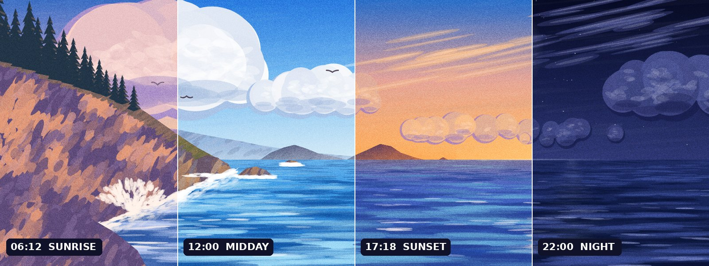
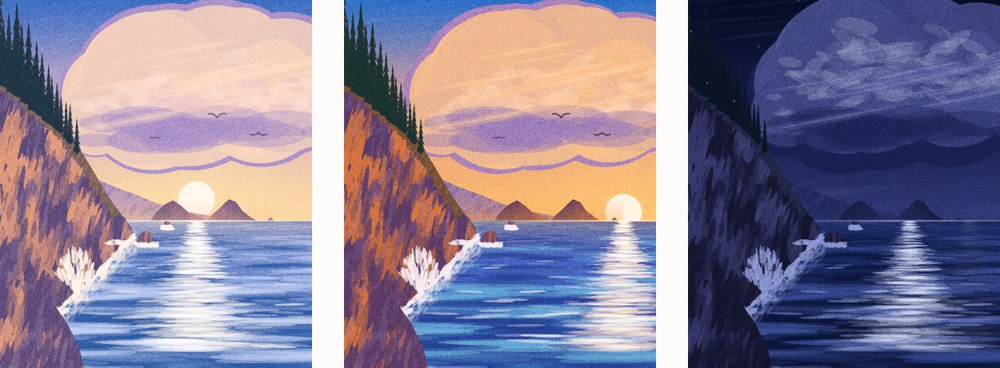
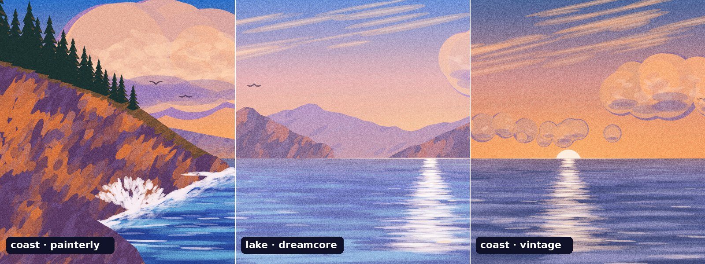

<div align="center">

# 🌅 Daylight Footer

**A painted website footer that follows the real sun: sunrise in the morning, golden sunset in the evening, moonlight at night.**

[简体中文](./README.zh-CN.md) · [Quick start](#quick-start) · [API](#api) · [Presets](#presets--palettes) · [Frameworks](#framework-recipes) · [Claude skill](#use-it-as-a-claude-skill)




</div>

---

## Why

Illustrated footers look great until every visitor sees the same sunset at 9 a.m. Daylight Footer repaints one composition on a `<canvas>`, using palettes interpolated across the **solar day** of a real city. The colours are tied to the sun, not the clock: golden hour lands on the actual golden hour in Ho Chi Minh City, Shanghai or London, in every season.

- 🌍 **Real solar time.** Sunrise and sunset come from the NOAA equation using the city's latitude and longitude. IANA time zones handle DST. With `'viewer'`, each visitor sees their own time.
- 🎨 **Painted, not photographed.** Gouache-style brush dabs, lit clouds, sea reflections, stars, a moon and gulls. No image assets.
- 📱 **Re-composed on phones.** In portrait, the scene is rearranged so the cliff, the trees and the sun all stay in view. Nothing important gets cropped off.
- ⚡ **Light.** 38 KB (14 KB gzip), no dependencies. The static layer repaints about once a minute, and animation pauses while the footer is off-screen.
- ♿ **Considerate.** Respects `prefers-reduced-motion` and dark mode, and caps device pixel ratio.
- 🧩 **Extensible.** Presets and palettes are plain objects, so you can paint a skyline, terraces or dunes with the same toolkit.

<div align="center">

<br><sub>Phone layout at 06:12 · 17:18 · 22:00</sub>
</div>

## Quick start

```html
<div id="daylight" style="height: clamp(260px, 37.5vw, 640px)"></div>

<script src="assets/daylight-scene.js"></script>
<script>
  DaylightScene.create(document.getElementById('daylight'), {
    city: 'hcm',          // Ho Chi Minh City
    palette: 'painterly',
    grain: true,
  });
</script>
```

For the complete footer, start from [`assets/footer-template.html`](assets/footer-template.html). It includes the brand block, three link columns, social icons, a zh/en toggle, dark mode and the phone layout, and every place you need to change is marked `EDIT:`.

Preview any hour from the browser console:

```js
DaylightScene.instances[0].setHour(18.2);   // dusk
DaylightScene.instances[0].setMode('demo'); // 24 hours in 32 seconds
```

## API

### `DaylightScene.create(container, options) → scene`

The container only needs a height. The engine inserts its own canvases.

| Option | Default | Description |
|---|---|---|
| `city` | `'hcm'` | City key, a `{lat, lon, timeZone, zh, en}` object, or `'viewer'` for the visitor's own time zone |
| `preset` | `'coast'` | Scene: `'coast'`, `'lake'` (load `presets/lake.js`), or your own |
| `palette` | `'painterly'` | `'painterly'`, `'dreamcore'`, `'vintage'`, or a keyframe array |
| `mode` | `'live'` | `'live'` (follow the clock), `'manual'`, or `'demo'` |
| `hour` | `17.5` | Starting clock hour for `manual` mode |
| `grain` | `true` | Film-grain overlay |
| `demoSeconds` | `32` | Length of one 24-hour demo cycle |
| `portraitBelow` | `1.4` | Width/height ratio below which the scene is re-composed for portrait |
| `focusX` | `0.56` | Horizontal focus point for the wide crop (0–1) |
| `dprCap` | `1.6` | Maximum device pixel ratio for the canvases |
| `onChange` | – | `(state) => {}`, called when the displayed minute or phase changes |

**Built-in cities:** `hcm` Ho Chi Minh City · `hanoi` · `bkk` Bangkok · `sha` Shanghai · `bj` Beijing · `szx` Shenzhen · `gz` Guangzhou · `hk` Hong Kong · `sg` Singapore

### Instance methods

| Method | |
|---|---|
| `setHour(h)` | Jump to a clock hour (switches to `manual`) |
| `setMode(m)` | `'live'`, `'manual'` or `'demo'` |
| `setCity(c)` | Change city and recompute sunrise and sunset |
| `setPalette(p)` / `setGrain(bool)` | Re-theme while running |
| `trackGradient()` | CSS gradient of the day's horizon colours, for a time slider |
| `getState()` | `{hour, time, phase, phaseName, sunriseText, sunsetText, mode, city}` |
| `redraw()` / `destroy()` | Force a repaint, or remove the scene and stop all observers |

### Utilities

```js
DaylightScene.sunTimes('sha');            // { rise: 6.2, set: 17.05, tz: 8 }  (local clock hours)
DaylightScene.cityHour('bkk');            // current local hour in Bangkok
DaylightScene.toPhase(h, rise, set);      // clock hour → solar phase (6 = sunrise, 18 = sunset)
DaylightScene.phaseName(p);               // { key: 'sunset', zh: '日落', en: 'Sunset' }
```

## Presets & palettes



| Palette | Look |
|---|---|
| `painterly` | Saturated gouache in the style of anime backgrounds (default) |
| `dreamcore` | Hazy lavender-pink pastels with soft contrast |
| `vintage` | Warm, faded film stock |

To make a brand palette in one line:

```js
const brand = DaylightScene.tintPalette(DaylightScene.PALETTES.painterly, [255, 120, 80], 0.18);
DaylightScene.create(el, { palette: brand });
```

Each palette is a set of keyframes over the solar phase, with 18 colour roles and 6 scalars per keyframe. See [`references/palettes.md`](references/palettes.md). To paint a new landscape, read [`references/scene-authoring.md`](references/scene-authoring.md); [`presets/lake.js`](assets/presets/lake.js) is a worked example of about 100 lines.

## How it works

```
clock time ──► sunTimes(city) ──► solar phase (sunrise ≡ 6, sunset ≡ 18)
                                        │
                                        ▼
                         palette keyframes ──► interpolated palette (18 colours + 6 scalars)
                                        │
          ┌─────────────────────────────┴──────────────────────────────┐
          ▼                                                            ▼
   static layer (repainted when the phase moves)        fx layer (every frame, only while visible)
   sky → sun/moon → clouds → far land → sea →           stars · glints · birds
   reflections → cliff, trees, surf
```

Everything is painted into a fixed 1600 × 600 logical frame with the horizon at y = 360. On wide screens the frame is scaled to cover the container. On portrait screens the preset's `layout()` squeezes the land groups and moves the sun's path into view, so the scene is rearranged rather than cropped.

## Framework recipes

| Target | Recipe |
|---|---|
| React / Vite | Mount in `useEffect`, call `destroy()` in cleanup |
| Next.js (App Router) | `'use client'` component, `import()` the engine inside the effect |
| Vue 3 / Nuxt | `onMounted` / `onBeforeUnmount`, wrap in `<ClientOnly>` |
| Astro | Inline `<script>` that imports the engine |
| WordPress / Webflow / Shopify | `python3 scripts/inline_engine.py footer.html` → paste one block |
| claude.ai artifact | Same inline script, then publish |

Full code for each is in [`references/integration.md`](references/integration.md).

## Verify before shipping

```bash
node scripts/preview.js path/to/page.html --out daylight-preview
```

This takes screenshots at 06:12, 12:00, 17:18 and 22:00, each at 1440 px and 390 px, and writes `report.json`. It exits non-zero on console errors, sideways scrolling or a blank canvas. It requires Playwright.

## Want detailed illustration instead?

If you need art that the procedural painter can't produce, [`references/ai-keyframes.md`](references/ai-keyframes.md) describes a second route: generate 4–6 AI keyframes with a locked composition (prompts in English and Chinese), then cross-fade them by solar phase using the same sun maths.

| | Procedural | AI keyframes |
|---|---|---|
| Payload | ~14 KB gzip | 0.6–1.8 MB of WebP |
| Transitions | Continuous | Cross-fades between keyframes |
| Detail | Flat gouache | Anything the image model can draw |

## Use it as a Claude skill

This repository is also a [Claude](https://claude.ai) skill. Claude reads `SKILL.md` and builds, adapts and verifies the footer for you.

```bash
# In any project
git clone https://github.com/baiiiii521/daylight-footer .claude/skills/daylight-footer
```

Then ask Claude something like *"a footer whose sky follows Bangkok time, dreamcore look"* or *"把日出日落页脚接入我们的 Next.js 项目"*.

## Project structure

```
daylight-footer/
├── SKILL.md                    # Claude skill entry point
├── assets/
│   ├── daylight-scene.js       # engine + 'coast' preset
│   ├── presets/lake.js         # 'lake' preset
│   └── footer-template.html    # production footer
├── scripts/
│   ├── preview.js              # screenshot + checks
│   └── inline_engine.py        # single-file build
├── references/                 # integration, palettes, scene authoring, AI keyframes
├── evals/                      # skill test cases
└── docs/                       # README images
```

## Browser support

All evergreen browsers (Chrome, Edge, Firefox, Safari 15.4+). The engine uses Canvas 2D, `ResizeObserver` and `IntersectionObserver`, and falls back gracefully when either observer is missing. `color-mix()` in the template's fade needs Safari 16.2+ or a recent Chromium or Firefox.

## Roadmap

- [ ] City-skyline preset (Saigon, Bangkok, Shanghai) with windows that light up at dusk
- [ ] Weather hook (clouds and rain from a forecast API)
- [ ] Minified ES-module build on npm

## License

[MIT](LICENSE) © 2026 baiiiii521
