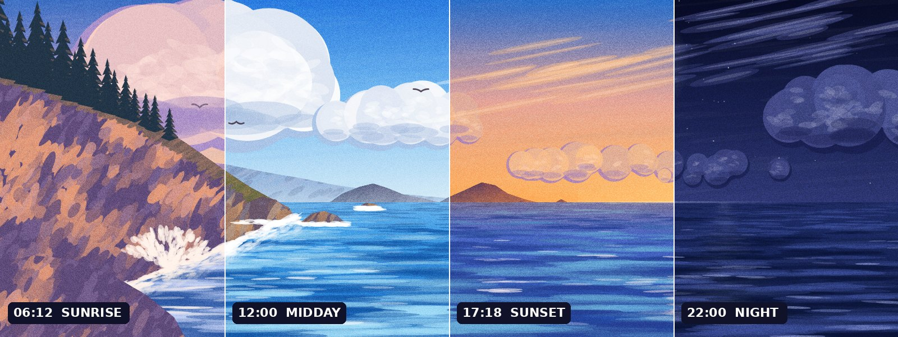
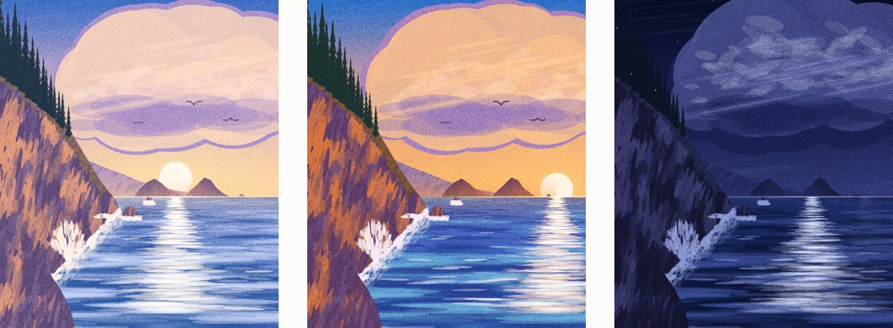
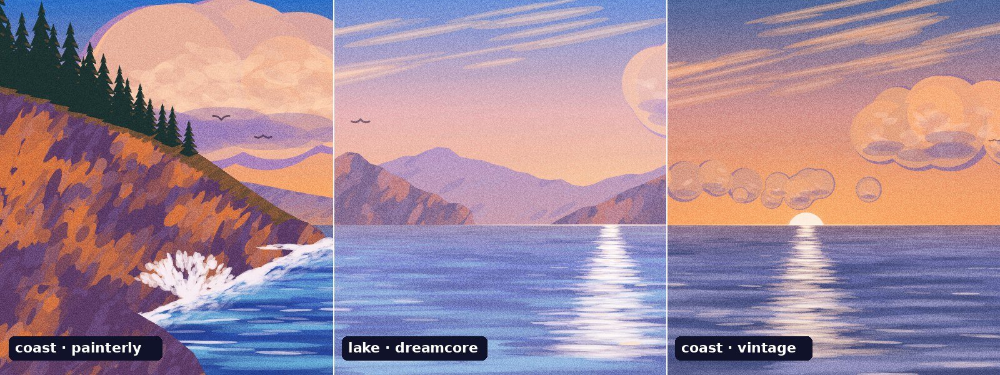

<div align="center">

# 🌅 Daylight Footer 昼夜页脚

**跟着真实太阳变化的手绘风网站页脚：清晨日出，傍晚金色日落，夜里月光星空。**

[English](./README.md) · [快速开始](#快速开始) · [API](#api) · [场景与配色](#场景与配色) · [框架接入](#框架接入) · [作为-claude-skill-使用](#作为-claude-skill-使用)




</div>

---

## 为什么做这个

插画页脚很好看，但如果早上 9 点打开网站看到的也是日落，就穿帮了。Daylight Footer 用 `<canvas>` 重新绘制同一个构图，配色按真实城市的**太阳一天的进程**插值。颜色跟着太阳走，而不是跟着钟表走：无论哪个季节，胡志明市、上海还是伦敦，黄金时刻都会出现在当地真正的黄金时刻。

- 🌍 **真实太阳时间**：用城市经纬度和 NOAA 公式计算日出日落，IANA 时区会自动处理夏令时。设为 `'viewer'` 时，每位访客看到的是自己的本地时间。
- 🎨 **画出来的，不是照片**：水粉笔触、受光的云、海面倒影、星星、月亮和海鸥，不用任何图片素材。
- 📱 **手机端重新构图**：竖屏时场景会重新排布，悬崖、松树和太阳都保持在画面内，不会被裁掉。
- ⚡ **轻量**：38 KB（gzip 后 14 KB），零依赖。静态层大约每分钟重绘一次，页脚离开屏幕时动画自动暂停。
- ♿ **体贴**：支持「减少动态效果」和深色模式，并限制设备像素比。
- 🧩 **可扩展**：场景和配色都是普通对象，可以用同一套工具画城市天际线、梯田或沙丘。

<div align="center">

<br><sub>手机端 06:12 · 17:18 · 22:00</sub>
</div>

## 快速开始

```html
<div id="daylight" style="height: clamp(260px, 37.5vw, 640px)"></div>

<script src="assets/daylight-scene.js"></script>
<script>
  DaylightScene.create(document.getElementById('daylight'), {
    city: 'hcm',          // 胡志明市
    palette: 'painterly',
    grain: true,
  });
</script>
```

完整页脚请从 [`assets/footer-template.html`](assets/footer-template.html) 开始。模板里已经包含品牌区、三列链接、社交图标、中英文切换、深色模式和手机布局，需要修改的地方都标了 `EDIT:`。

在浏览器控制台里可以预览任意时刻：

```js
DaylightScene.instances[0].setHour(18.2);   // 暮色
DaylightScene.instances[0].setMode('demo'); // 32 秒走完 24 小时
```

## API

### `DaylightScene.create(container, options) → scene`

容器只需要设定高度，画布由引擎自己插入。

| 参数 | 默认值 | 说明 |
|---|---|---|
| `city` | `'hcm'` | 城市代码、`{lat, lon, timeZone, zh, en}` 对象，或 `'viewer'`（访客本地时区） |
| `preset` | `'coast'` | 场景：`'coast'` 海岸、`'lake'` 山湖（需加载 `presets/lake.js`），或自定义场景 |
| `palette` | `'painterly'` | `'painterly'`、`'dreamcore'`、`'vintage'`，或自定义关键帧数组 |
| `mode` | `'live'` | `'live'` 跟随时钟、`'manual'` 手动、`'demo'` 演示 |
| `hour` | `17.5` | `manual` 模式下的起始时刻 |
| `grain` | `true` | 胶片颗粒 |
| `demoSeconds` | `32` | 演示模式下走完 24 小时用的秒数 |
| `portraitBelow` | `1.4` | 宽高比低于这个值时，按竖屏重新构图 |
| `focusX` | `0.56` | 宽屏裁切时的水平焦点（0–1） |
| `dprCap` | `1.6` | 画布的最大设备像素比 |
| `onChange` | – | `(state) => {}`，显示的分钟或时段变化时调用 |

**内置城市：** `hcm` 胡志明市 · `hanoi` 河内 · `bkk` 曼谷 · `sha` 上海 · `bj` 北京 · `szx` 深圳 · `gz` 广州 · `hk` 香港 · `sg` 新加坡

### 实例方法

| 方法 | 说明 |
|---|---|
| `setHour(h)` | 跳到指定时刻（会切换到 `manual` 模式） |
| `setMode(m)` | `'live'`、`'manual'` 或 `'demo'` |
| `setCity(c)` | 切换城市，并重新计算日出日落 |
| `setPalette(p)` / `setGrain(bool)` | 运行中更换配色或开关颗粒 |
| `trackGradient()` | 返回一天中地平线颜色的 CSS 渐变，可用作时间滑块的背景 |
| `getState()` | `{hour, time, phase, phaseName, sunriseText, sunsetText, mode, city}` |
| `redraw()` / `destroy()` | 强制重绘，或移除场景并停止所有监听 |

### 工具函数

```js
DaylightScene.sunTimes('sha');            // { rise: 6.2, set: 17.05, tz: 8 }（当地钟点）
DaylightScene.cityHour('bkk');            // 曼谷当前时刻
DaylightScene.toPhase(h, rise, set);      // 钟点 → 太阳相位（6 = 日出，18 = 日落）
DaylightScene.phaseName(p);               // { key: 'sunset', zh: '日落', en: 'Sunset' }
```

## 场景与配色



| 配色 | 风格 |
|---|---|
| `painterly` | 动画背景风格的饱和水粉（默认） |
| `dreamcore` | 朦胧的薰衣草粉，低对比 |
| `vintage` | 暖色调的褪色胶片 |

一行代码生成品牌配色：

```js
const brand = DaylightScene.tintPalette(DaylightScene.PALETTES.painterly, [255, 120, 80], 0.18);
DaylightScene.create(el, { palette: brand });
```

每套配色是一组按太阳相位排列的关键帧，每个关键帧包含 18 种颜色角色和 6 个数值，详见 [`references/palettes.md`](references/palettes.md)。想画新的风景，请看 [`references/scene-authoring.md`](references/scene-authoring.md)；[`presets/lake.js`](assets/presets/lake.js) 是一个约 100 行的完整示例。

## 工作原理

```
钟点 ──► sunTimes(城市) ──► 太阳相位（日出 ≡ 6，日落 ≡ 18）
                                  │
                                  ▼
                   配色关键帧 ──► 插值后的配色（18 种颜色 + 6 个数值）
                                  │
          ┌───────────────────────┴────────────────────────┐
          ▼                                                ▼
   静态层（相位变化时重绘）                    动画层（每帧绘制，仅在可见时运行）
   天空 → 日月 → 云 → 远景 → 海面 →           星星 · 波光 · 飞鸟
   倒影 → 悬崖、树、浪花
```

所有内容都画在一个固定的 1600 × 600 逻辑画框里，地平线在 y = 360。宽屏时画框按铺满容器的方式缩放；竖屏时由场景的 `layout()` 在水平方向压缩陆地，并把太阳轨迹移到可视区内，所以手机上是重新排布画面，而不是裁掉一部分。

## 框架接入

| 目标 | 做法 |
|---|---|
| React / Vite | 在 `useEffect` 里挂载，在 cleanup 里调用 `destroy()` |
| Next.js（App Router） | 写成 `'use client'` 组件，在 effect 里用 `import()` 加载引擎 |
| Vue 3 / Nuxt | 使用 `onMounted` / `onBeforeUnmount`，外层包 `<ClientOnly>` |
| Astro | 在内联 `<script>` 里 import 引擎 |
| WordPress / Webflow / Shopify | 运行 `python3 scripts/inline_engine.py footer.html`，得到一整段代码直接粘贴 |
| claude.ai artifact | 同样先内联成单文件，再发布 |

每种做法的完整代码见 [`references/integration.md`](references/integration.md)。

## 上线前检查

```bash
node scripts/preview.js path/to/page.html --out daylight-preview
```

脚本会分别在 1440px 和 390px 宽度下截取 06:12、12:00、17:18、22:00 四个时刻，并生成 `report.json`。遇到控制台报错、页面横向滚动或画布空白时，脚本以非零状态退出。需要预先安装 Playwright。

## 需要更精细的插画？

如果需要代码绘制达不到的画面细节，[`references/ai-keyframes.md`](references/ai-keyframes.md) 介绍了另一种做法：先锁定构图，用 AI 生成 4–6 张关键帧（提示词有中英对照），再用同一套太阳算法按相位交叉淡化。

| | 代码绘制 | AI 关键帧 |
|---|---|---|
| 体积 | 约 14 KB gzip | 0.6–1.8 MB WebP |
| 过渡 | 连续变化 | 关键帧之间交叉淡化 |
| 细节 | 扁平水粉 | 图像模型能画出的任何内容 |

## 作为 Claude skill 使用

这个仓库本身也是一个 [Claude](https://claude.ai) skill。Claude 会读取 `SKILL.md`，替你搭建、改造并验证页脚。

```bash
# 在任意项目的根目录运行
git clone https://github.com/baiiiii521/daylight-footer .claude/skills/daylight-footer
```

之后直接对 Claude 说，例如「做一个按曼谷时间变化的页脚，梦核风格」，或「把日出日落页脚接入我们的 Next.js 项目」。

## 项目结构

```
daylight-footer/
├── SKILL.md                    # Claude skill 入口
├── assets/
│   ├── daylight-scene.js       # 引擎 + 'coast' 海岸场景
│   ├── presets/lake.js         # 'lake' 山湖场景
│   └── footer-template.html    # 正式上线用的页脚模板
├── scripts/
│   ├── preview.js              # 截图 + 检查
│   └── inline_engine.py        # 内联成单文件
├── references/                 # 框架接入、配色、自定义场景、AI 关键帧
├── evals/                      # skill 测试用例
└── docs/                       # README 用图
```

## 浏览器支持

支持所有自动更新的现代浏览器（Chrome、Edge、Firefox、Safari 15.4+）。引擎使用 Canvas 2D、`ResizeObserver` 和 `IntersectionObserver`，缺少任一 Observer 时会自动降级。模板渐隐效果用到的 `color-mix()` 需要 Safari 16.2+，或较新的 Chromium / Firefox。

## 路线图

- [ ] 城市天际线场景（西贡、曼谷、上海），黄昏时楼宇窗户逐渐亮灯
- [ ] 天气联动（根据天气预报 API 显示云量和雨）
- [ ] 发布压缩版 ES 模块到 npm

## 许可证

[MIT](LICENSE) © 2026 baiiiii521
